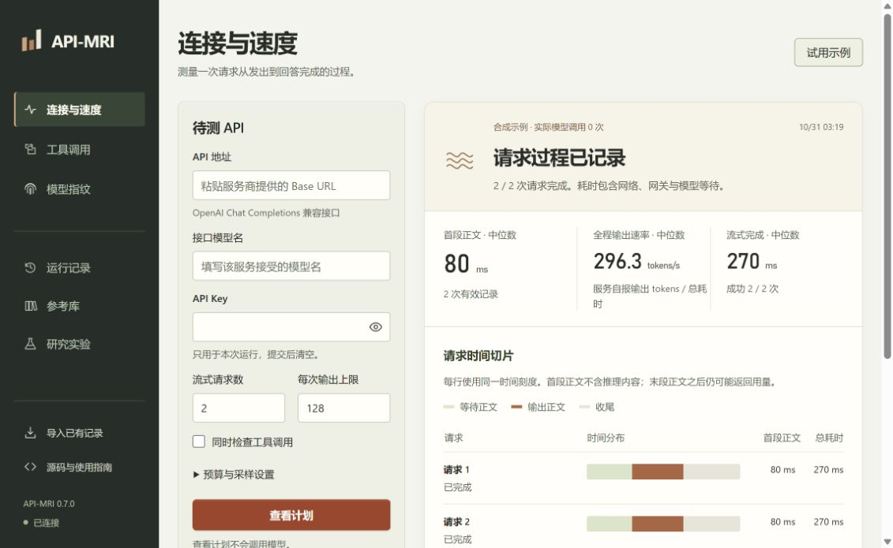
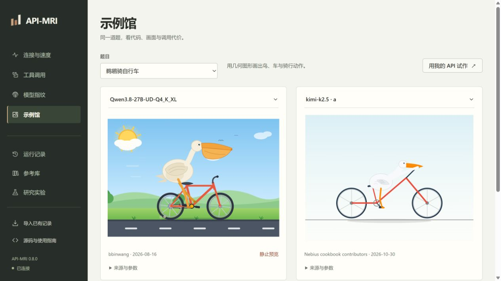

# API-MRI · API 检查工作台

API-MRI 中的 MRI 指 **Model Response Inspector**。原名 Relay Audit；旧命令 `relay-audit` 仍可使用。

连接一个大模型 API，检查它的响应过程、工具调用与模型指纹。MRI 也借用了磁共振的含义：把服务拆成几个可观察的切面，查看每一项证据。

| 检查 | 能看到什么 | 默认预算 |
| --- | --- | --- |
| 连接与速度 | 请求成功与错误、首正文等待、完整耗时、流式间隔、服务端用量对应的全程输出速率 | 2 请求，256 输出配额 |
| 工具调用 | 指定工具及参数、结果回填、自主选用、无需工具的回答 | 至多 4 请求，512 输出配额 |
| 模型指纹 | 与 132 个公开参考标签的距离、逐探针贡献、排名轨迹和删题敏感性 | 32 请求，512 输出配额 |
| 经典题试作 | 鹈鹕骑自行车等题目的 SVG / HTML、图形预览、用量与耗时 | 1 请求，默认 2,048 输出上限 |

先看计划，再开始采样；所有请求串行发送，无自动重试。输出配额按请求参数累加，输入与额外推理计费另记。结果和 JSONL 留在本机，已有记录可反复离线复算。没有 Key 也可以试用合成示例。

工具展示候选和家族排序，也会返回“库外或行为变化”“证据不足”。参考采于 2026 年 7 月；32 请求的历史留出测试中，131 个有效标签 Top-1 为 103/131、Top-3 为 121/131，门槛放行 64 例，其中 1 例选错。逐题证据和排名稳定性用于解释这次排序，现网识别效果仍待校准。[模型识别方法](docs/model-identification.md) · [服务测量方法](docs/service-quality.md)



这是清华大学《人工智能发展与治理》第 11 小组研究的附加开源工具。我们关注模型服务的商业承诺怎样被验证，以及用户取得证据需要付出什么成本。

## 开始使用

**Windows 用户：** 在 [Releases](https://github.com/Lee-Eee-Eee/API-MRI/releases/latest) 下载 `API-MRI-0.8.0-windows-x64.zip`，完整解压后双击 `API-MRI.exe`。无需安装 Python。浏览器打开工作台，另有一个小窗口用于打开页面和退出程序。使用与升级步骤见[便携版指南](docs/portable.md)。

安装后点击“试用示例”，即可查看流式时间线和工具调用结果。示例使用本地合成响应；模型指纹示例从参考分布合成，两者均不调用模型 API。

**DSH 用户：** 安装 [Better Sidebar 插件](dsh-plugin/README.md)，在侧栏连接已启动的 API-MRI。Windows 便携版与源码版都可作为后端；Release 同时提供 `dsh-api-mri-0.8.0.tgz` 和插件发现页索引。

**只想看作品：** 打开“示例馆”，可浏览 24 幅公开 SVG 和 13 条原作链接，按模型并排查看。首批题目有鹈鹕骑车、章鱼弹管风琴、海星开推土机、钟表、六边形弹球和动画鹈鹕。浏览不发模型请求；试作前展示单次请求与输出上限。每份作品保留提示、出处和已知参数。[来源与使用方法](docs/classic-examples.md)



以下是源码安装方式，适合修改代码或在 Linux / macOS 使用。

先安装 [Git](https://git-scm.com/downloads) 和 [Python](https://www.python.org/downloads/)，推荐 Python **3.11 或 3.12**。工具可在 CPU 上运行。安装依赖需要联网，无密钥示例与记录复算不调用模型 API。

### Windows · PowerShell

```powershell
git clone https://github.com/Lee-Eee-Eee/API-MRI.git
cd API-MRI
py -3.12 -m venv .venv
.\.venv\Scripts\python.exe -m pip install --upgrade pip
.\.venv\Scripts\python.exe -m pip install torch==2.8.0 --index-url https://download.pytorch.org/whl/cpu
.\.venv\Scripts\python.exe -m pip install -e ".[api,ui,dev]"
.\.venv\Scripts\api-mri.exe ui
```

若已安装 Python 3.11，把 `py -3.12` 改为 `py -3.11`。以上命令直接使用虚拟环境里的程序，无需修改 PowerShell 执行策略。

### Linux / macOS · 终端

```bash
git clone https://github.com/Lee-Eee-Eee/API-MRI.git
cd API-MRI
python3 -m venv .venv
source .venv/bin/activate
python -m pip install --upgrade pip
```

Linux 安装 CPU 版 Torch：

```bash
python -m pip install torch==2.8.0 --index-url https://download.pytorch.org/whl/cpu
```

macOS 使用对应平台的 PyPI 版本：

```bash
python -m pip install torch==2.8.0
```

接着安装并启动：

```bash
python -m pip install -e '.[api,ui,dev]'
api-mri ui
```

在浏览器打开 **http://127.0.0.1:8765**，保留启动终端，按 `Ctrl+C` 停止。工作台只接受本机访问；端口冲突时加 `--port 8766`。已进行的平台测试见[验证记录](docs/validation.md)，Linux/macOS 的安装路径不等于已完成对应平台验证。

## 已有版本的升级

如果已经安装旧版，在原仓库目录更新源码，再用同一虚拟环境卸载旧发行包、安装新发行包。目录可以继续叫 `relay-audit`，已有运行记录和参考缓存保留。

Windows PowerShell：

```powershell
git pull
.\.venv\Scripts\python.exe -m pip uninstall -y relay-audit
.\.venv\Scripts\python.exe -m pip install -e ".[api,ui,dev]"
.\.venv\Scripts\api-mri.exe ui
```

Linux/macOS 在已激活虚拟环境的终端中：

```bash
git pull
python -m pip uninstall -y relay-audit
python -m pip install -e '.[api,ui,dev]'
api-mri ui
```

发行包现名为 `api-mri`，Python 模块仍为 `relay_audit`。新旧命令 `api-mri`、`relay-audit` 指向同一入口。

## 第一次检测

1. 选择“连接与速度”“工具调用”或“模型指纹”；第一次可点击“试用示例”。
2. 真实采样填写 API 地址和接口接受的模型别名，例如 `https://api.example.com/v1`。查看计划不请求模型，也不需要 Key。
3. 核对请求数、输出配额和检查项，填入 Key 后开始。修改配置会使旧计划失效，提交后 Key 清空。
4. 查看逐请求记录或逐探针解释，导出 JSONL。运行记录可以重开，“导入已有记录”可复算服务、候选识别、KBF 与双端点证据。

连接检查记录的是本机发出 HTTP 请求后的过程，响应头等待包含网络和服务端处理。流式块可能含多个 token；没有服务端用量时，token/s 保留未知，仍显示正文接收时间和字符速率。工具测试只读取本地合成表，四项结果分别计分。[指标定义与工具任务](docs/service-quality.md)

服务测量的命令行入口：

```bash
api-mri service-demo --out runs/service-demo-01
api-mri service-plan --config examples/service.example.json
api-mri service --config service.json --out runs/service-01
api-mri service-replay --records runs/service-01/service_records.jsonl --out runs/service-replay-01
```

真实调用前复制配置模板，填写地址、模型名，并用 `api_key_env` 指定密钥环境变量。`checks` 可选 `["stream"]`、`["tools"]` 或两项。

命令行可以直接体验：

```bash
api-mri identify-demo --out runs/identify-demo-01
api-mri identify-plan --config examples/identify.example.json
```

真实调用用 `identify`，配置中的 `api_key_env` 指向本机环境变量。请求输出配额是各次 `max_tokens` 之和；输入和额外推理费用另记，未返回用量保留未知。套餐须允许自动 API 调用。

运行结果保存在启动目录的 `runs/ui/`。页面 Key 用于本次连接，提交后清空，不写入配置或浏览器持久化设置。报告和原始回答保存到本机。

## 指定模型对照（KBF）

需要核对某个具体版本时，在“模型指纹”中选择“指定型号对照”，搜索参考包、查看来源和日期。默认使用最多 4 请求的低成本初筛，只列差异和缺失；选择“完整参考比较”后沿用 KBF 判据。题目、请求数和配额在开始前展示。KBF 与候选识别使用不同探针，不能按请求数直接比较准确率。

### KBF 结果怎样读

| 结果 | 含义和下一步 |
| --- | --- |
| 初筛完成，尚不能判断模型身份 | 查看这次抽取的题目中哪些回答不同、哪些缺失；短样本没有经过鉴别能力校准，不返回 SAME / DIFF |
| 发现显著差异（DIFF） | 在这份参考包及其设置下，待测回答的偏离达到判据。先核对版本、提示处理和输出限制，再考虑复采 |
| 未检出明显差异（SAME） | 本次探针没有检出超过参考基线的偏离；保留这次记录，按实际服务变化安排复核 |
| 证据不足（UNDETERMINED） | 覆盖不足、解析失败、条件不符或其他问题妨碍比较，按报告原因修正 |

**SAME 是方法返回的标签，不是模型真伪认证。** 模型版本、参数或中转处理都可能改变回答。报告保留参考来源及日期，让结果对应到具体条件。[参考包说明](docs/reference-packs.md)解释数据从哪里来、怎样比较，以及哪些变化需要更新参考。

完整模式中，只要计划内题目存在未解析的回答，就返回“证据不足”。只回答容易匹配的题目不能获得“未检出明显差异”的结论。初筛选题在运行前固定，不会看到答案后反复加题直至出现显著结果。

内置参考从 4 份扩展到 **26 份**，包含 GPT-6 Astra、Claude Opus 5 / Fable 5.1、DeepSeek V4 Pro 0813、Kimi K3 等作者记录的版本。数据来自 KBF 的 2026 年 9 月目录，逐包核对探针格式、提示与领域配置、自测记录和文件哈希。模型名、提供方和采集渠道来自作者记录，尚未由本组独立认证。完整数量和版本见[来源清单](docs/reference-packs.md#内置参考包)。采集日期与模型发布日期是两回事；参考列表表示当前有数据可比对的版本。

## 更新参考库

在“参考库”中点击更新。工具从固定的 [KBF 作者仓库](https://github.com/Ooo0ption/KBF)读取公开 JSON，先冻结本次 Git 提交，再检查兼容性和哈希，合格的数据保存在本机 `runs/reference-library/`。它不需要 API Key，也不调用模型。

更新详情会区分新增、已有和跳过的数据。提示、领域或自测不兼容的包会说明原因；网络失败或 GitHub 限流也会明确显示。旧版本保留供历史记录复算，操作不会下载或执行远程代码。上游没有新增参考时，更新不会产生新模型数据；刚发布的型号仍可能没有可用参考。详细流程见[更新指南](docs/user-guide.md#抓取参考库更新)。

## 命令行

以下命令在虚拟环境激活后使用；Windows 也可将 `api-mri` 换成 `.\.venv\Scripts\api-mri.exe`。

```bash
api-mri references
api-mri references-update --library-dir runs/reference-library
api-mri reference-audit --out runs/reference-audit-01
```

需要单独管理缓存时，`references`、`references-update`、`fingerprint-*` 和 `ui` 均可加 `--library-dir path/to/library`；一起使用的命令指定同一目录。默认是启动目录下的 `runs/reference-library/`。

复制 [fingerprint.example.json](examples/fingerprint.example.json) 为 `fingerprint.json`，填写参考包 ID 和候选端配置，保留 `api_key_env` 为环境变量名称。随后执行：

```bash
api-mri fingerprint-plan --config fingerprint.json
api-mri fingerprint --config fingerprint.json --out runs/fingerprint-01
```

`fingerprint-plan` 只检查计划。真实运行前，按照[密钥输入指南](docs/user-guide.md#在命令行中提供密钥)设置候选端的环境变量。

示例配置包含 `"profile": "screening"` 和 `"budget": {"max_requests": 4, "max_output_tokens": 4096}`。完整比较使用 `"profile": "full"`，可保留自定预算；删除 `budget` 则使用完整计划的默认上限。旧配置省略 `profile` 时也会采用初筛，历史记录复算仍按其原始完整计划处理。

无需 Key 的示例和离线复算：

```bash
api-mri fingerprint-demo --reference-pack gpt-4.1-mini_20260915 --profile screening --variant different --out runs/fingerprint-demo-01
api-mri fingerprint-replay --reference-pack gpt-4.1-mini_20260915 --records runs/fingerprint-demo-01/fingerprint_records.jsonl --out runs/fingerprint-replay-01
```

示例支持 `match`、`different` 和 `incomplete`，分别展示匹配、偏离和记录不足。复算时使用原来那份参考包和候选记录，不会再次请求模型。每次使用新的输出目录，保留已有证据。

`reference-audit` 读取本机参考，列出采集渠道、留存自测/其他模型记录及两种模式的调用计划，输出 Markdown 与 JSON。它可帮助安排后续校准；已有参考的自测偏离不代表真实误报率。

我们还用公开的短答案指纹数据做了[独立统计复算](docs/low-cost-evidence.md)，检查减少问题后的信息损失。复算脚本和结果随仓库提供，原始数据从作者发布页下载；v0.6 在此基础上另做参考、校准和测试拆分，加入[多候选识别](docs/model-identification.md)；原拆半等错误率不作新模式门槛。

## 进阶：双端点比较与课堂实验

当你需要自己的任务或现有参考库没有覆盖目标版本时，可以提供两端参考，使用 Inspect 采集和 MET 逐题分布比较：

```bash
api-mri plan --config pair.json
api-mri run --config pair.json --out runs/pair-01
api-mri compare --reference runs/pair-01/reference.jsonl --candidate runs/pair-01/candidate.jsonl --out runs/replay-01
```

先将[双端点模板](examples/pair.template.json)复制为 `pair.json`，修改地址和模型。这里需要两端各自的 Key；采样参数和任务两端共享，MET 结论与单 API 指纹标签分别解释。

“研究实验”中的六个可控情境展示同来源、模型替换、混合路由、提示改写、输出截断和请求不稳定。特别可以对照“替换”与“提示改写”：程序让它们产生相同的回答观察，帮助讨论还需要哪些证据才能判断原因。

```bash
api-mri lab --scenario prompt_rewrite --out runs/lab-01
```

服务研究档案把模型、价格、路由、数据用途和补救声明与测量结果并列，进一步连接课程的市场与治理问题。详见[研究背景](docs/research-context.md)。

## 复用与验证

候选识别复用 [One Token Is Enough](https://zenodo.org/records/21278557) 的共同提示和公开回答；指定模型对照复用 [KBF](https://github.com/Ooo0ption/KBF) 的公开参考及评分方法；高级双端点路线继续使用 [Inspect AI](https://github.com/UKGovernmentBEIS/inspect_ai) **0.3.278** 和 [Model Equality Testing](https://github.com/irenasaracay/model-equality-testing) **0.0.2**。本项目负责参考来源展示、采集与记录、本地工作台和报告解释。

新增代码采用 MIT 许可；KBF 及其他第三方材料保留原许可、来源和固定版本，详见 [THIRD_PARTY.md](THIRD_PARTY.md)。[验证记录](docs/validation.md)区分程序测试、合成示例和真实模型实验，不用流程通过率代替检测准确率。

开发时运行：

```bash
python -X utf8 -m pytest -q
```

反馈问题时提供复现步骤、参考包 ID、组件版本和合成样例即可。参考库覆盖、更新和实测校准仍是研究的一部分，更多说明见[参考包指南](docs/reference-packs.md)。
