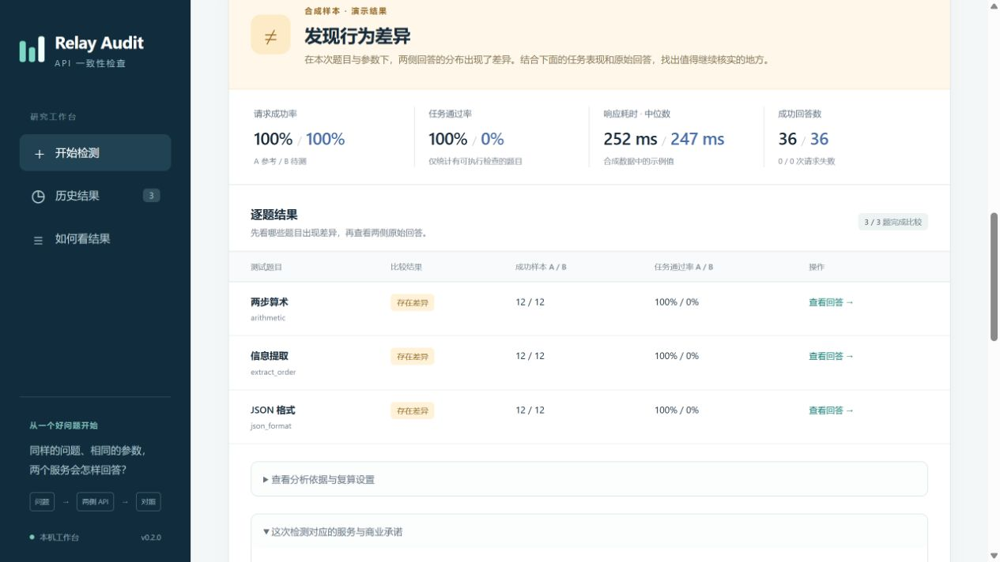

# relay-audit · API 服务一致性检测工作台

把同一组任务发给参考 API 和待测 API，比较回答分布、任务完成情况、请求成功率和耗时，并保存可复查的本地报告。你可以先跑一次免费离线演示，再接入自己的端点；已有记录也能导入重新分析。

这是清华大学《人工智能发展与治理》第 11 小组研究的附加开源工具，当前版本 **0.2.0**。它帮助定位“哪些表现不同、为什么暂时无法比较”。检出行为差异后，还需要核对模型版本、采样配置及服务承诺；工具没有服务端模型身份认证能力。

## 现在能做什么

- **浏览器工作台**：离线演示、可控实验台、双端点检测、JSONL 离线复算，显示运行进度、取消操作和历史结果。
- **六个可控情境**：同来源、替换、混合路由、提示改写、输出截断和请求不稳定，观察不同机制留下的信号。
- **一组配置，两端采集**：共享提示、重复次数和生成参数，轮换两端的请求顺序，每次完成后保存记录。
- **五个可选任务**：算术、JSON 格式、信息提取、排序和上下文查找，支持明确答案或格式检查。
- **读得懂的结果**：先看结论和原因，再看成功率、耗时中位数/P95、自报 token 与逐题比较。
- **本地导出**：JSON 完整报告、Markdown 阅读报告和 Excel 可打开的 CSV；原始回答留在本地证据文件中。
- **研究档案**：记录服务的模型、价格、路由、数据政策与补救承诺，将公开声明、本次观察和下一步需取得的证据放到同一份报告。



上图来自本地合成实验；回答、耗时与计量为演示数据。

## 安装并打开界面

先安装 [Git](https://git-scm.com/downloads) 和 [Python](https://www.python.org/downloads/)。推荐 Python **3.11 或 3.12**；项目要求至少 3.10。下面的命令都在终端执行，安装依赖需要联网，运行离线演示不调用模型 API。工具使用 CPU 即可。

### Windows：PowerShell

打开 PowerShell，依次执行：

```powershell
git clone https://github.com/Lee-Eee-Eee/relay-audit.git
cd relay-audit
py -3.12 -m venv .venv
.\.venv\Scripts\python.exe -m pip install --upgrade pip
.\.venv\Scripts\python.exe -m pip install torch==2.8.0 --index-url https://download.pytorch.org/whl/cpu
.\.venv\Scripts\python.exe -m pip install -e ".[api,ui,dev]"
.\.venv\Scripts\relay-audit.exe ui
```

若安装的是 Python 3.11，把 `py -3.12` 改为 `py -3.11`。也可以用已确认版本的 `python -m venv .venv`。这些命令直接使用虚拟环境里的程序，无需修改 PowerShell 执行策略。

### Linux / macOS：终端

```bash
git clone https://github.com/Lee-Eee-Eee/relay-audit.git
cd relay-audit
python3 -m venv .venv
source .venv/bin/activate
python -m pip install --upgrade pip
```

Linux 先安装 CPU 版 Torch：

```bash
python -m pip install torch==2.8.0 --index-url https://download.pytorch.org/whl/cpu
```

macOS 使用 PyPI 提供的对应平台版本：

```bash
python -m pip install torch==2.8.0
```

然后继续：

```bash
python -m pip install -e '.[api,ui,dev]'
relay-audit ui
```

在浏览器打开 **http://127.0.0.1:8765**。终端需要保持运行；按 `Ctrl+C` 关闭服务。工作台只监听本机。若端口被占用，用 `relay-audit ui --port 8766` 并打开对应地址；Windows 命令前加 `.\.venv\Scripts\`。

Windows 是已验证的平台。Linux/macOS 提供上述安装路径，具体平台验证情况见[验证记录](docs/validation.md)。

## 第一次使用：先看演示

1. 在工作台选择 **离线演示**，使用默认参数启动。
2. 等待模拟采样和分析完成。演示会比较同来源的两组模拟回答，以及刻意改变后的模拟回答。
3. 查看结论、逐题结果和回答记录，下载 Markdown 或 CSV。演示用量是人为设定值，不对应账单。

运行结果默认保存在 `runs/ui/`。关闭后重新启动工作台，可以从历史记录打开已保存的结果。

## 课堂上可以怎样演示

打开 **可控实验台**，先选择同来源情境，再依次观察“模型替换”和“提示改写”。这两个情境可以产生相同的回答观察结果，适合讨论：看到了回答差异，接下来还需要哪些证据才能判断原因？

混合路由、输出截断和请求不稳定三个情境，则让你观察路由、输出上限和请求错误如何影响报告。实验台完全在本机生成数据，回答、耗时与用量都是预设值。它把原理和证据边界变成可操作的课堂问题。

也可以在检测前填写 **服务研究档案**：摘录具体套餐的模型、价格或数据政策声明，注明来源链接和观察日期。报告会将声明与结果并列，例如行为信号可以支持复查模型配置，数据留存承诺则需要政策及运营材料补充。档案不会发送给被测 API。

## 配置一次双端点检测

在 **双端点检测** 中填写参考端与待测端的 Base URL、API Key 和服务标识，选择相同的模型名称及版本，再勾选任务。Base URL 是兼容接口的根地址，例如 `https://api.example.com/v1`，通常不包含 `/chat/completions`。

页面会显示预计请求数和输出 token 上限。先检查计划，再启动。实际请求数为 `题目数 × 每题重复次数 × 2`；例如 3 道题、每题 12 次，共 72 次请求。输出上限不等于账单，输入、推理及服务端的其他计费项目需另按套餐核算。

参考端应来自你已核实的渠道。当前双端点模式要求两侧接受相同的模型标识；该字段会实际发送给 API。若两侧只接受不同别名，需先核实版本对应关系并解决名称映射，不能仅修改标签来建立可比性。执行前确认账户允许自动 API 调用，并使用无个人信息的任务。真实采集可能计费。

界面中的 Key 只用于当前运行的内存，不保存为配置或浏览器持久化设置。每次请求结束后，工具脱敏已知密钥和认证字段再导出记录；异常上游若把密钥回显，原生日志在完成脱敏前可能短暂包含它。日志和 JSONL 保存到本机，包含测试任务及回答。点击取消会在当前请求结束或超时后停止后续调用，保留已完成记录。

[完整使用指南](docs/user-guide.md)介绍字段含义、导入格式、结果解释和常见错误。

## 命令行使用

以下命令假定虚拟环境已激活。Windows 也可把 `relay-audit` 换成 `.\.venv\Scripts\relay-audit.exe`。

### 演示和离线复算

```bash
relay-audit demo --out runs/demo-01
relay-audit compare --reference runs/demo-01/reference.jsonl --candidate runs/demo-01/substituted.jsonl --out runs/replay-01
relay-audit lab --scenario prompt_rewrite --out runs/lab-01
```

每次使用新的输出目录，已有结果会保留。演示的报告位于 `runs/demo-01/honest/` 和 `runs/demo-01/substituted/`；离线复算的报告位于 `runs/replay-01/`。

### 双端点计划与采集

复制 [pair.template.json](examples/pair.template.json) 为 `pair.json`，修改地址、模型和任务。配置文件只写环境变量名称，不写 Key 值。

```bash
relay-audit plan --config pair.json
relay-audit run --config pair.json --out runs/pair-01
```

`plan` 检查配置与请求上限，不请求模型，也不读取密钥。`run` 使用 `RELAY_REFERENCE_KEY` 和 `RELAY_CANDIDATE_KEY` 等配置中指定的环境变量；[完整指南](docs/user-guide.md#通过命令行提供密钥)提供不把 Key 写进命令历史的输入方式。

`run` 和 `compare` 可加 `--study study.json` 附带研究档案，文件格式见[使用指南](docs/user-guide.md#将服务承诺带入研究报告)。档案只保存在本地报告中。

仍可用 [endpoint.template.json](examples/endpoint.template.json) 单独采集一端：

```bash
relay-audit collect --config endpoint.json --out runs/endpoint-01
```

## 怎样理解结果

| 结果 | 可以采取的下一步 |
| --- | --- |
| 发现行为差异 | 核对版本、参数与上下文处理，用新的样本复核，并结合实际服务承诺解释 |
| 证据不足：条件不匹配或采集不完整 | 按中文原因修正配置，检查错误和缺失样本后重新采样 |
| 证据不足：本次未检出差异 | 本次方法未找到显著差异；真实模型检出能力尚未校准，可在设计好对照和预算后进一步验证 |

任务通过率衡量少数预设任务，耗时含网络与排队，token 来自服务端自报。它们各自回答不同问题，不能合成一个“模型真假分数”。

## 复用的方法和代码

[Inspect AI](https://github.com/UKGovernmentBEIS/inspect_ai) **0.3.278** 负责模型适配、任务执行和原生日志；[Model Equality Testing](https://github.com/irenasaracay/model-equality-testing) **0.0.2** 负责逐题两样本分布检验。本项目增加双端点采样、匹配检查、Monte Carlo 加一修正、Holm 多题校正、描述性指标和本地界面。字符分布检验不等于语义能力评分，`min_samples` 是运行门槛，不保证检出能力。

MET 初始化需要其包元数据未声明的 Transformers，本项目显式补齐依赖；运行这些任务不需要下载模型权重或分词器。新增代码采用 MIT 许可，第三方组件保留各自许可，详见 [THIRD_PARTY.md](THIRD_PARTY.md)。

方法论文：Irena Gao, Percy Liang, Carlos Guestrin. *Model Equality Testing: Which Model is this API Serving?* ICLR 2025. [正式论文](https://proceedings.iclr.cc/paper_files/paper/2025/hash/d73234a13815fc1f9779dd17d89be9b4-Abstract-Conference.html)。

## 开发与问题反馈

```bash
python -m pytest -q
```

[验证记录](docs/validation.md)区分本地流程测试与真实模型实验；[研究背景](docs/research-context.md)说明工具在市场、服务承诺与治理研究中的作用。当前尚未开展真实模型校准和商业端点测量。

提交问题时附复现步骤、组件版本及合成样例即可。代码和文档由 AI 辅助开发，修改通过对应测试后记录；研究解释仍需研究者复核。
